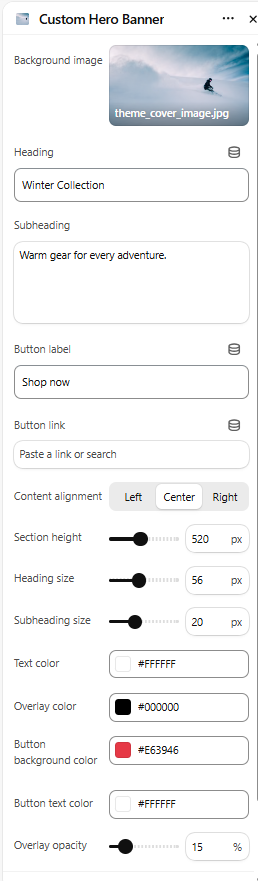

# Shopify Liquid Sections

Custom Shopify sections I'm building while strengthening my Liquid skills.

## Custom Hero Banner

A customizable hero banner section for Online Store 2.0 themes. Everything can be edited from the theme editor, with no code changes needed.

### Settings in the theme editor

| Setting | Type |
|---|---|
| Background image | Image picker |
| Heading / Subheading | Text / Textarea |
| Button label and link | Text / URL |
| Content alignment | Select (left, center, right) |
| Section height | Range (300–800 px) |
| Heading size / Subheading size | Range (px) |
| Text color, overlay color, button colors | Color pickers |
| Overlay opacity | Range (0–90%) |

### What I practiced
- Writing a section schema with different setting types
- Passing schema values into CSS with Liquid (`section.settings`)
- Responsive images with `image_url` and `image_tag`
- Making typography editable with range settings and CSS `clamp()`
- Mobile-specific height with a media query
- Debugging with browser DevTools: found a theme rule (`div:empty { display: none }`) hiding the empty overlay element, and fixed it with `display: block`

### Install
Copy `sections/custom-hero-banner.liquid` into your theme's `sections` folder, then add "Custom Hero Banner" from the theme editor.

## Custom Slider

A customizable slider section for Online Store 2.0 themes. Slides and styling can be edited from the theme editor, with no code changes needed.

### Settings in the theme editor
- Slide content (heading and text for each slide)
- Overlay opacity
- Autoplay speed
- Arrows on/off
- Dots on/off
- Content padding
- Responsive layout for mobile

### Install
Copy `sections/custom-slider.liquid` into your theme's `sections` folder, then add "Custom Slider" from the theme editor.

---
